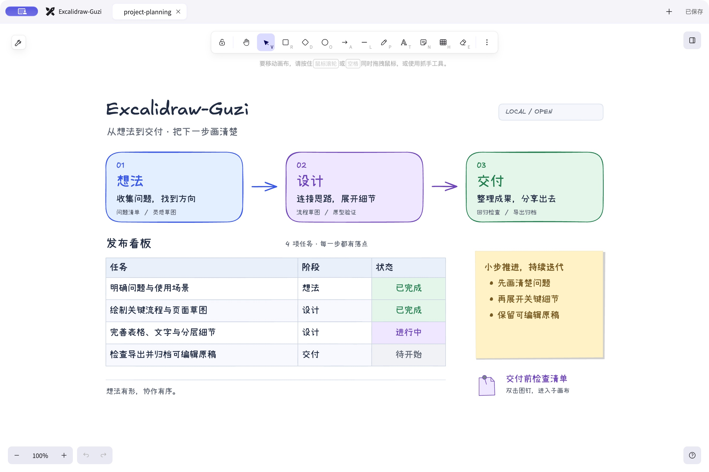
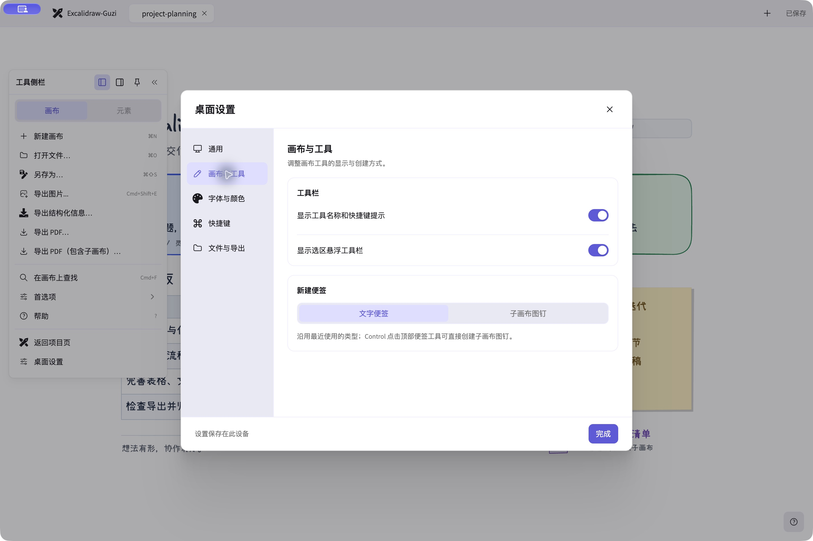

# Excalidraw-Guzi

**Excalidraw-Guzi（谷子白板）** 是基于 [Excalidraw](https://github.com/excalidraw/excalidraw) 二次开发的**免费开源 macOS 桌面白板**。用简洁的面板和顺手的快捷键，把想法、论文笔记和流程图整理成自己的图片知识库。保留手绘画布与 `.excalidraw` 文件格式，并加入本地工作区、可编辑表格、富文本、子画布和自定义样式预设。

本项目使用 [MIT 开源许可](./LICENSE)。感谢 Excalidraw 团队与所有贡献者提供优秀的画布基础。

[下载与版本记录](https://github.com/Drangon-Li/guzi-graph/releases) · [反馈问题](https://github.com/Drangon-Li/guzi-graph/issues) · [上游仓库](https://github.com/excalidraw/excalidraw)

## 72 秒认识谷子白板

看完 _Attention Is All You Need_，怎样把 Transformer 画成自己的知识？这段宣传片结合双人动画与 **macOS 实机操作**，演示画框与连线、逐字输入、快捷键、表格构建 Causal Mask，以及用子画布展开 Q、K、V 笔记。

[](https://github.com/Drangon-Li/guzi-graph/releases/download/v0.3.0/Guzi-Final-Full.mp4)

[观看／下载完整版（1080p，约 72 秒）](https://github.com/Drangon-Li/guzi-graph/releases/download/v0.3.0/Guzi-Final-Full.mp4) · [中文字幕](https://github.com/Drangon-Li/guzi-graph/releases/download/v0.3.0/Guzi-Promo-zh.srt) · [可编辑 Transformer 示例](./examples/guzi/transformer-attention.excalidraw) · [视频制作与素材署名](./docs/promo-video.md)

视频为非官方同人演示，使用社区合成配音；第三方角色、模型与声音素材不属于本仓库 MIT 许可的授权范围。

## 软件截图





## 主要功能

- **手绘画布**：图形、箭头、自由绘制、文字、图片、便签、分组与画框，支持缩放和撤销重做。
- **本地工作区**：项目页、文件预览、多标签和文件夹分类；可设置默认画布目录，在多个文档之间切换。
- **表格**：插入与编辑表格，增删行列、合并或拆分单元格，调整行高、列宽、文字与边框样式。
- **富文本**：文字支持粗体、斜体、下划线、底色、有序与无序列表、缩进、行间距和段间距。
- **子画布**：将便签转为子画布图钉，进入独立画布展开细节，通过导航返回上层；子画布与主画布保存在同一文件中。
- **自定义偏好**：设置默认字体、字号与颜色快捷项，可添加本机字体；配置绘图样式预设及其快捷键，选中元素时应用样式，未选中时切换绘图工具。
- **桌面体验**：中英文界面、浅色／深色／跟随系统主题，支持调整工具提示和选区悬浮工具栏。
- **多种导出**：PNG、SVG、PDF，以及带图片附件的 JSON / Markdown 结构化导出。

## 安装

v0.3.0 面向 **macOS Apple Silicon（arm64）**，安装包名为 `Excalidraw-Guzi-0.3.0-arm64.dmg`。暂未提供 Intel Mac、Windows 或 Linux 安装包。

1. 在 [Releases](https://github.com/Drangon-Li/guzi-graph/releases) 下载对应版本的 DMG。
2. 打开 DMG，将 **Excalidraw-Guzi.app** 拖入「应用程序」。
3. 从「应用程序」启动，也可用它打开 `.excalidraw` 文件。

当前构建使用 ad-hoc 签名，**尚未经过 Apple 公证（notarization）**。首次启动可能受到 Gatekeeper 限制；确认安装包来源后，可在 macOS「系统设置 → 隐私与安全性」中按系统提示允许打开。

## 开始使用与经典示例

1. 在项目页新建画布（`⌘N`），或打开已有文件（`⌘O`）。
2. 使用顶部工具绘图，选中元素后调整属性；在桌面设置中配置字体、颜色与样式预设。
3. 使用 `⌘S` 保存，或使用 `⌘⇧S` 另存为 `.excalidraw` 文件。
4. 从画布主菜单导出图片、PDF 或结构化信息，返回项目页管理文件。

保存下面的 `.excalidraw` 文件，用 Excalidraw-Guzi 打开即可继续编辑：

- [项目规划](./examples/guzi/project-planning.excalidraw)：流程图、任务表格与分层整理。
- [Transformer 与 Attention](./examples/guzi/transformer-attention.excalidraw)：Encoder / Decoder 架构、参数表与 QKV 子画布，来自宣传片的实机演示。
- [Encoder / Decoder 入门](./examples/guzi/encoder-decoder.excalidraw)：宣传片中通过复制、连线与改色创建的简洁示例。

编辑会自动写入本地恢复草稿，可从草稿恢复入口找回未保存内容。**自动草稿不等于原文件已保存**，需要长期保留的内容仍应显式保存。

项目页的「删除」只从应用中隐藏画布，原文件保留，重新打开即可加入项目页；「彻底删除」会将原文件移到 macOS 废纸篓。两种操作首次都会提示，并可分别选择不再提示。尚未恢复的草稿会保留；当前文档的未保存改动仍会询问保存或放弃。

## 选择导出格式

| 格式 | 适合用途 | 保留内容与边界 |
| --- | --- | --- |
| `.excalidraw` | 保存、备份、继续编辑 | 保留本应用的画布、子画布与图片资源；继续编辑时优先使用 |
| PNG | 文档插图、聊天分享 | 栅格图片，可在导出面板调整相关选项 |
| SVG | 网页插图、缩放展示 | 矢量图形与嵌入的图片资源 |
| PDF | 阅读、打印、分享 | 当前画布单页，或选择包含子画布、每个画布分别成页；页面按画布尺寸生成，不按 A4 自动分页 |
| JSON | 程序处理、结构检查 | 节点、连接、原文、几何、绑定、资源与结构关系，包含关联的子画布 |
| Markdown | 阅读、笔记整理 | 按推断阅读顺序组织正文，提供结构、连接、子画布和图片引用 |

### JSON 与 Markdown

从主菜单选择「导出结构化信息…」，可预览 JSON 或阅读视图，并切换是否根据位置推断分区。预览与保存使用打开对话框时的同一画布快照。

结构化导出保留有效元素 ID、原始文字、连接端点、箭头方向及几何信息。画框、分组和文本绑定属于显式结构；矩形包含关系属于可选的位置推断。阅读顺序依据布局启发式生成，并标记为推断，不表示已理解图中的业务含义。

可用图片另存到导出文件旁的 `guzi-assets-…/` 目录，JSON 和 Markdown 使用相对路径引用。移动或分享时，请将导出文件与附件目录一起保留。缺失或无法解码的资源会在导出诊断中体现。

**边界**：结构化导出不执行 OCR，不调用 AI 理解图片或推断业务语义，也不是可无损回导的画布格式。复杂布局的阅读顺序和位置推断需要人工复核。新增表格、富文本、子画布等能力由本项目实现，其他 Excalidraw 客户端不保证完整呈现；请保留原始 `.excalidraw` 文件，并使用本应用继续编辑。

### PDF

PDF 导出先将画布转为 SVG，再通过 Electron 的打印接口生成 PDF。页面包含导出边距，并使用画布背景等导出设置；原图中的位图仍是位图。选择「导出 PDF（包含子画布）…」时，关联的非空子画布会分别追加为页面。PDF 用于展示，不包含可恢复编辑的 Excalidraw 场景。

## 开发与构建

仓库保留 Excalidraw monorepo 结构；桌面应用位于 [`excalidraw-desktop/`](./excalidraw-desktop)，画布核心位于 [`packages/`](./packages)。

需要 Node.js **22.12.0 或更高版本**和 Yarn **1.22.22**。生成 DMG 需要 macOS；首次安装依赖与打包可能需要下载 Electron 和构建工具。

```bash
yarn install --frozen-lockfile

# 启动桌面开发环境（Vite + Electron）
yarn desktop:dev

# 类型检查与桌面测试（Electron 主进程 + renderer）
yarn desktop:typecheck
yarn desktop:test

# 构建桌面前端
yarn desktop:build

# 构建 Apple Silicon DMG
yarn desktop:package
```

桌面构建输出位于 `excalidraw-desktop/dist/`，打包产物位于 `excalidraw-desktop/release/`。只生成 `.app` 目录可运行：

```bash
npm --prefix excalidraw-desktop run package:dir
```

修改画布核心后，按受影响范围运行相关测试，例如：

```bash
yarn test:app run packages/excalidraw/tests/table.test.tsx packages/excalidraw/tests/subcanvas.test.tsx
yarn test:app run packages/excalidraw/wysiwyg/richTextWysiwyg.test.tsx
```

本地构建沿用 ad-hoc 签名配置，不会自动完成 Developer ID 签名或 Apple 公证。

## 上游与许可

本项目基于 [Excalidraw](https://github.com/excalidraw/excalidraw) 修改，遵循 [MIT License](./LICENSE)，保留上游版权与许可声明。Excalidraw-Guzi 是独立修改版本；感谢并致敬 Excalidraw 团队与开源社区。

上游资料：[使用 Excalidraw](https://excalidraw.com) · [组件文档](https://docs.excalidraw.com) · [开发指南](https://docs.excalidraw.com/docs/introduction/development)。上游网站提供的在线协作、分享等功能不代表本地桌面应用提供相同服务。
