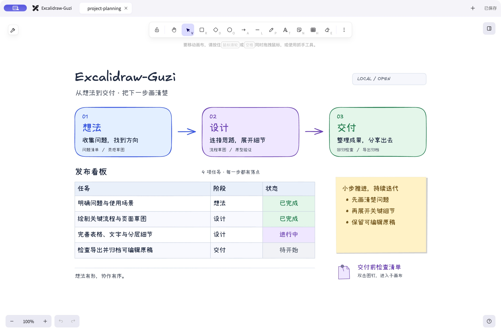

<h1 align="center">谷子白板 Excalidraw-Guzi</h1>

<p align="center">
  <b>把想法、论文笔记和流程图画成自己的知识库。</b><br />
  基于 Excalidraw 的免费开源手绘白板，增加了表格、富文本、子画布、多页演示和本地工作区
</p>

<p align="center">
  <a href="https://graph.guzilab.com">在线使用</a> ·
  <a href="https://g.guzilab.com">官网</a> ·
  <a href="https://github.com/holamochi/guzi-graph/releases/latest">下载桌面版</a> ·
  <a href="docs/user-guide.md">使用指南</a> ·
  <a href="https://github.com/holamochi/guzi-graph/issues">反馈问题</a> ·
  <a href="https://github.com/excalidraw/excalidraw">上游 Excalidraw</a>
</p>


<details>
<summary><b>▶ 72 秒宣传片</b>：用 Transformer 论文演示画框、连线、表格和子画布</summary>

https://github.com/user-attachments/assets/261fd3b2-ab8a-4186-8e3d-64b3bbf11995

[下载原版视频（1080p）](https://github.com/holamochi/guzi-graph/releases/download/v0.3.0/Guzi-Final-Full.mp4) · [中文字幕](https://github.com/holamochi/guzi-graph/releases/download/v0.3.0/Guzi-Promo-zh.srt) · [视频里的可编辑示例](./examples/guzi/transformer-attention.excalidraw) · [制作说明与素材署名](./docs/promo-video.md)

视频与封面为非官方同人演示，使用社区合成配音；其中的第三方角色、模型与声音素材不在本仓库 MIT 许可的授权范围内。

</details>

## 为什么做谷子白板

Excalidraw 很适合随手画草图，但用它整理知识时会遇到瓶颈：画不了真正的表格，文字不能分级排版，细节一多画布就乱，做汇报还得另开 PPT。

谷子白板保留了 Excalidraw 的手绘风格和 `.excalidraw` 文件格式，补上了这些能力，并提供一个本地桌面版，画布文件就存放在你自己的文件夹里。



## 亮点

- **表格**：插入可编辑表格，支持增删行列、合并拆分单元格，调整行高、列宽和边框样式。
- **富文本**：支持粗体、斜体、下划线、底色、有序和无序列表、缩进，以及行间距、段间距。
- **LaTeX 公式**：输入 LaTeX 即可预览，双击可以重新编辑源码。
- **子画布**：把便签变成子画布的入口，点进去展开细节，再一键返回上层；所有内容保存在同一个文件里。
- **演示文稿**：制作多页手绘幻灯片，支持拖拽排序、放映、页面备注，以及整份导出为 PDF。
- **本地工作区**：提供项目页、文件预览、多标签和文件夹分类，画布文件都存在你自己的目录里。
- **样式预设与快捷键**：自定义字体、颜色和绘图样式预设，并为常用样式设置快捷键。
- **AI 可操作**：内置 MCP 服务，Codex 等客户端可以创建、编辑、导出画布和演示文稿；也能通过 MCP 开发插件，在 Market 中启用。
- **多种导出**：支持 PNG、SVG、PDF，以及带图片附件的 JSON / Markdown 结构化导出。

## 在线版和桌面版

|  | 在线版 | 桌面版 |
| --- | --- | --- |
| 获取方式 | 打开 [graph.guzilab.com](https://graph.guzilab.com)，无需安装和注册 | [下载安装包](https://github.com/holamochi/guzi-graph/releases/latest) |
| 手绘画布、图片、表格、富文本 | ✓ | ✓ |
| 文件保存在哪里 | 当前浏览器（不跨设备同步，请定期导出备份） | 本机文件夹 |
| 本地工作区、多页演示文稿 | — | ✓ |
| MCP、Market 插件 | — | ✓ |
| PDF 和 JSON / Markdown 结构化导出 | — | ✓ |
| 多人协作、云分享 | — | — |

## 下载安装

| 平台 | 安装包 |
| --- | --- |
| macOS（Apple Silicon） | [Releases](https://github.com/holamochi/guzi-graph/releases/latest) 中的 `Excalidraw-Guzi-<版本>-arm64.dmg` |
| Windows 10 / 11 x64 | 同一发布页的 `Excalidraw-Guzi-<版本>-win-x64.exe`，或免安装的 `-unpacked.zip` |

Windows 版暂缓日常迭代，后续按大版本集中更新，开发会继续。暂不提供 Intel Mac 和 Linux 安装包。如果 GitHub 下载较慢，可以到[官网](https://g.guzilab.com)使用国内下载线路。

> **首次打开被系统拦截？** macOS 安装包使用 ad-hoc 签名，尚未经过 Apple 公证，请在「系统设置 → 隐私与安全性」中按提示允许打开。Windows 安装包没有代码签名，系统可能会提示「未知发布者」。

旧版本升级问题、Windows 安装细节见 [使用指南 · 桌面版安装](docs/user-guide.md#桌面版安装)。

## 快速上手

1. 在项目页新建画布（`⌘N` / `Ctrl+N`），或打开已有的 `.excalidraw` 文件（`⌘O` / `Ctrl+O`）。
2. 用顶部工具栏绘图，选中元素后调整属性。
3. 按 `⌘S` / `Ctrl+S` 保存。
4. 从主菜单导出图片、PDF 或结构化信息。

想先看看效果，可以下载这些示例，用谷子白板打开：[项目规划](./examples/guzi/project-planning.excalidraw) · [Transformer 与 Attention](./examples/guzi/transformer-attention.excalidraw) · [Encoder / Decoder 入门](./examples/guzi/encoder-decoder.excalidraw)

MCP 连接、各导出格式的边界、草稿与删除规则等，都在 [使用指南](docs/user-guide.md) 中。

## 参与开发

```bash
yarn install --frozen-lockfile
yarn desktop:dev         # 启动桌面开发环境（Vite + Electron）
yarn desktop:test        # 桌面测试
yarn desktop:package     # 构建 Apple Silicon DMG
```

需要 Node.js ≥ 22.12.0 和 Yarn 1.22.22。这个仓库是 monorepo：`apps/desktop/` 是桌面应用，`apps/web/` 是网页应用，`packages/` 是画布核心。Windows 打包、单人网页版构建与部署见 [docs/building.md](docs/building.md)，Windows 验收见 [docs/windows-desktop.md](docs/windows-desktop.md)。

## Topic / Keywords

- **解决的问题**：手绘白板适合画草图，但在整理论文笔记、知识结构和汇报演示时，缺少表格、富文本、分层展开和多页放映，画布文件也往往锁在网页或云端。
- **实现方式**：在 Excalidraw 画布内核上增加可编辑表格、富文本、LaTeX、子画布（嵌套画布）、多页演示文稿和本地文件工作区；文件保持 `.excalidraw` 格式；内置 MCP Server，AI 客户端可以直接创建和编辑画布。
- **产品类别**：白板 / 绘图工具 · 流程图与架构图 · 视觉笔记 · 手绘风演示文稿 · Electron 桌面应用 + 网页版 · Excalidraw 二次开发
- **容易混淆**：它不是 Excalidraw 官方版本，也不是 excalidraw.com；不提供多人实时协作和云分享；在线版只在浏览器本地保存。
- **中文关键词**：白板、手绘白板、在线白板、流程图、思维导图替代、论文笔记、知识图谱、可视化笔记、画布表格、子画布、嵌套画布、手绘幻灯片、LaTeX 公式、本地优先、免费开源
- **English keywords**: whiteboard, hand-drawn whiteboard, Excalidraw fork, Excalidraw desktop app, diagramming, flowchart, visual notes, knowledge canvas, tables in Excalidraw, rich text, nested canvas, sub-canvas, slides, presentation, LaTeX, local-first, MCP server, Electron, open source

## TL;DR

> 谷子白板：基于 Excalidraw 的免费白板，多了表格、富文本、子画布和多页演示，可以直接在线使用，也可以下载桌面版把画布存在本地。

## Link

- GitHub 仓库：https://github.com/holamochi/guzi-graph
- 在线使用：https://graph.guzilab.com
- 官网：https://g.guzilab.com
- 上游项目 Excalidraw：https://github.com/excalidraw/excalidraw
- 同类项目：
  - tldraw（无限画布白板）：https://github.com/tldraw/tldraw
  - draw.io Desktop（流程图与架构图）：https://github.com/jgraph/drawio-desktop
  - Obsidian Excalidraw（在 Obsidian 中使用 Excalidraw）：https://github.com/zsviczian/obsidian-excalidraw-plugin

## 开源许可

本项目基于 [Excalidraw](https://github.com/excalidraw/excalidraw) 修改，以 [MIT License](./LICENSE) 开源，并保留上游的版权与许可声明。Excalidraw-Guzi 是独立的修改版本，感谢 Excalidraw 团队与开源社区。

上游网站提供的在线协作、分享等功能，不代表本项目的桌面版或在线版也提供。
